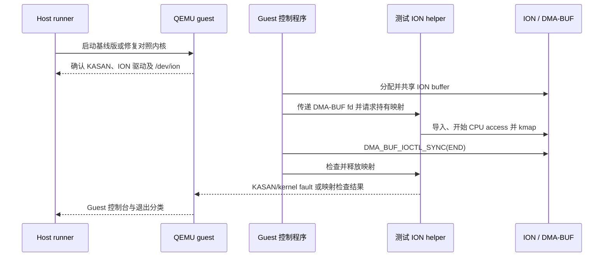

# ION CVE-2021-0929 QEMU KASAN 回归计划（2026-11-15）

## 当前状态与基线

分支 `main`，基线提交 `85611241bf89`（`feat: ion backend demo scratch.`）。该提交新增 `src/core/tests/ion_backend_demo.cpp` 和独立构建脚本。Demo 调用 `DMA_BUF_IOCTL_SYNC` 并传入 `DMA_BUF_SYNC_END`，但没有独立内核客户端持有映射，因此仅凭 ioctl 结果无法确认缺陷是否存在。文件还包含堆喷射/提权占位内容。Makefile 目标有错误的输出目录命令和变量名，当前没有 QEMU/KASAN 流程。保留未跟踪的 `src/out/` 和本地 `upstream/main` 缺失的两个提交。

使用上游 stable Linux `v4.14.116` 作为基线（peeled commit `6d1510d86ef67e5fadb8038671e2ec43416daf7f`）。该版本的 ION 源码在 `ion_dma_buf_end_cpu_access()` 中递减共享的内核映射计数；`ion_dma_buf_kmap()` 返回 `buffer->vaddr`，而 `ion_dma_buf_kunmap()` 不管理该映射。Android 修复将内核 map/unmap 的所有权从 `begin_cpu_access`/`end_cpu_access` 移到 DMA-BUF map/unmap 回调。对照版本从同一份 v4.14.116 源码构建，仅应用该 ION 修复，从而排除其他内核版本变化的影响。

源码依据：[上游 stable v4.14.116 ION 实现](https://github.com/gregkh/linux/blob/v4.14.116/drivers/staging/android/ion/ion.c)；[Android common ION 生命周期修复 41a097c0](https://android.googlesource.com/kernel/common/+/41a097c0ed6658bf451c5cf993ab0469eb1ce4a5)。

## 目标与约束

- 确认上游 Linux 4.14.116 是否包含 ION 映射生命周期缺陷，并与同源加修复补丁的结果比较。
- 两个版本都在启用 KASAN 和真实 ION 驱动的 AArch64 QEMU `virt` guest 中运行。每个 guest 必须有可工作的 `/dev/ion`；仅创建占位设备节点不符合要求。
- 使用最小 initramfs；不需要 Android framework，也不仿真 Kirin 990 闭源硬件。
- 本批次不要求 RXE dma-buf MR 支持；用户将在后续自行实现。不得在此添加 RXE 支持或声称本批次测试了 RXE MR 路径。
- 删除堆喷射/提权占位内容。测试范围仅限观察 `DMA_BUF_SYNC_END` 是否使内核客户端仍持有的 ION 映射失效。
- 不运行现有 native 测试；它们不验证 ION 行为，也没有能同时运行全部用例的单一内核配置。
- 生成的内核、initramfs 镜像和日志默认放在源码树之外的 `~/.tmp/ghostlock-ion-kasan-<uid>`，可通过 `ION_KASAN_BUILD_DIR` 覆盖。

## Runner 用法

使用 `bash tools/ion-kasan-test/build-and-run.sh` 执行完整的基线/修复对照。若要组合自定义流程，可 source 脚本后按 profile 名调用 build 和 guest helper：

```bash
source tools/ion-kasan-test/build-and-run.sh
profile=custom-example
build-kernel "$profile"                 # 可选第二个参数：内核源码目录
run-guest "$profile"
```

Source 只会定义 helper，不会获取内核源码、创建构建目录或改变调用 shell 的选项。各 helper 会在 `ION_KASAN_BUILD_DIR` 下按 profile 复用稳定产物。

## 变更清单

| 文件 | 变更 | 原因 |
|---|---|---|
| `src/core/tests/ion_backend_demo.cpp` | 改为 guest 侧 ION 控制程序；删除堆喷射/提权占位内容，记录分配、共享和 sync 结果。 | 保留测试入口，聚焦于回归观察。 |
| 新增 `tools/ion-kasan-test/` | 添加最小 initramfs、测试专用内核 helper 和 runner。Helper 导入 demo 的 DMA-BUF，调用 `dma_buf_begin_cpu_access()` 和 `dma_buf_kmap()`，在 demo 执行未配对的 `DMA_BUF_SYNC_END` 时持有映射，随后检查并释放映射。 | 匹配受影响的共享 kmap 计数生命周期；demo 本身无法观察其他内核客户端拥有的映射。 |
| 新增 `tools/ion-kasan-test/build-and-run.sh` | 运行上游 stable v4.14.116 原版/修复版完整对照，或提供可 source 的 `build-kernel PROFILE [KERNEL_SOURCE]` 与 `run-guest PROFILE` helper。 | 在不需要 Android framework 的情况下提供受控对照和可复用构建块。 |
| `src/Makefile` | 修复 demo 构建目标，并添加可选 QEMU 回归目标。 | 接入项目构建入口。 |
| `build-core.sh` | 用明确的 ION QEMU 回归目标替换硬编码 NDK/native-test 流程及会删除 `./out` 的命令。 | 保护已有输出数据，并匹配本次测试范围。 |
| 新增 `.github/workflows/ion-kasan-regression.yml` | 添加可选 workflow，运行 QEMU 回归并上传 guest 日志。 | 保留 CI 证据，不影响日常发布构建。 |
| 英文和中文计划 | 记录设计与实际门禁结果。 | 保持双语设计/证据同步。 |

## 数据流/控制流变化

当前：demo 发送 `DMA_BUF_SYNC_END`，但没有由其他客户端持有 ION 内核映射，无法检查缺陷不变量。

目标：host runner 从同一份上游 v4.14.116 源码构建原版和修复对照版。两者启用 KASAN 与 ION，在最小 initramfs 中启动，并验证真实 ION 驱动已注册 `/dev/ion`。Helper 导入 buffer，依次调用 `dma_buf_begin_cpu_access()` 和 `dma_buf_kmap()`，并保留返回的指针。Guest 控制程序运行 demo 的未配对 sync-end 操作后，helper 检查并释放映射。两种内核均记录 ioctl 结果、helper 结果、KASAN 报告或内核 fault 及完整 QEMU 控制台。不将结果解释为 RXE dma-buf MR 覆盖。



## 兼容性与回滚

Android 正式二进制、route catalog、profile wire format 和 backend dispatch 均保持不变。Helper 仅为测试 guest 构建。可选目标需要 QEMU、内核构建工具链和网络访问以获取固定版本的 Linux 源码。回滚时删除测试文件及 Makefile/workflow 条目；不涉及设备状态或迁移。

## 验证矩阵

| 检查 | 命令/环境 | 预期结果 |
|---|---|---|
| 现有 native 测试 | 按任务范围不运行。 | 它们不覆盖该内核行为。 |
| Guest 前置条件 | `make -C src ion-kasan-regression` | Runner 确认 arm64 QEMU、KASAN、ION system heap、实际 ION 驱动及可用的 `/dev/ion`；缺少时作为基础设施错误失败。 |
| 上游基线 | 同一命令 | 启动未修改的上游 stable Linux v4.14.116，记录 demo、helper、KASAN 和控制台观察结果。 |
| 修复对照版 | 同一命令 | 启动同一源码仅应用 ION 修复的版本，并记录相同观察结果。 |
| 回归结论 | 比较两份日志与配置 | 基线呈现映射失效；修复版保留仍被持有的映射。如果没有预期差异，报告“测试未能证明修复”，不得判通过。 |
| CI | PR 或手动触发 workflow | 上传两份配置和 guest 日志；只有观察到预期基线/对照差异时通过。 |

## 已记录的 QEMU 结果

2026-11-15 执行 `ION_KASAN_KERNEL_SOURCE=/tmp/ion-kasan-linux JOBS=8 make -C src ion-kasan-regression` 并通过。环境为 QEMU AArch64 `virt`、Cortex-A57、2 个 vCPU、2 GiB RAM。两个 guest 均输出 `KernelAddressSanitizer initialized`，打开由内核注册的 `/dev/ion`，分配 4096 字节 system-heap DMA-BUF，并成功执行 `DMA_BUF_SYNC_END`。基线随后在 `ion_probe_ioctl` 访问仍被持有的映射时触发页故障（`Unable to handle kernel paging request`，地址正是该映射）；修复对照版输出 `ION_PROBE_TOUCH_OK`、`ION_TEST_PASS` 和 `ION_GUEST_PASS`。两个 `.config` 的 SHA-256 均为 `58f2bb633ee568b5e82cc9e623c4b11e467c97043f6d28c53003831cea5dffea`。

两个内核都启用了并初始化了 KASAN，但基线表现为 ARM64 页表故障，而非 KASAN use-after-free 报告：探针访问前 `vunmap()` 已移除了映射。这确认上游 4.14.116 在启用 KASAN 的 guest 中具有该 ION 映射生命周期缺陷；不声称 KASAN 输出了 UAF 诊断。完整 guest 日志位于 `/tmp/ghostlock-ion-kasan-1000/baseline-qemu.log` 和 `/tmp/ghostlock-ion-kasan-1000/fixed-qemu.log`。

本批次不运行 host native tests、生产 NDK build、lint-tidy、`cmp_disasm` 或真机门禁，因为不修改生产攻击代码，所需内核行为在 QEMU 中观察。QEMU guest 日志、KASAN 输出和精确源码/配置标识构成证据。RXE dma-buf MR 支持留给后续任务。

## 明确保留范围

- 保留 `src/out/` 下全部未跟踪文件。
- 保留原始本地 `main` ref 和 scratch 提交 `85611241`；本次工作从仓库约定的 `very-not-stable-dev` 贡献分支提交。
- 贡献分支历史包含两个仅在上游的新提交；不改写远程 ref。
- 不改生产 backend dispatch、route catalog、profile/Kotlin 契约、exploit 阶段或发布 workflow。
- 不添加堆喷射、提权、RXE dma-buf 支持或 Kirin 设备仿真。
- 不修改上游内核源码；单独构建固定源码的修复对照树。

## 进度

- [x] 检查 demo、构建约定、设计要求及 ION 修复行为。
- [x] 纳入范围：不跑 native 测试；要求真实 `/dev/ion`/驱动；使用不含 Android framework 的 QEMU；推迟 RXE dma-buf 支持。
- [x] 用户确认范围：vanilla 4.14.116 ION 缺陷；本批次不实现 RXE dma-buf 支持。
- [x] 实现 guest helper、QEMU runner 和可选流水线。
- [x] 运行基线/修复版 KASAN 对比并记录真实观察结果。
- [ ] 完成贡献 PR、评审、CI、合并及本地 ref 更新门禁。
